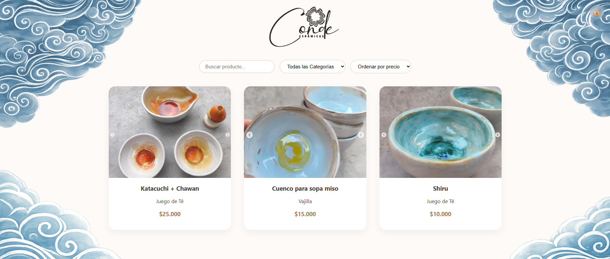
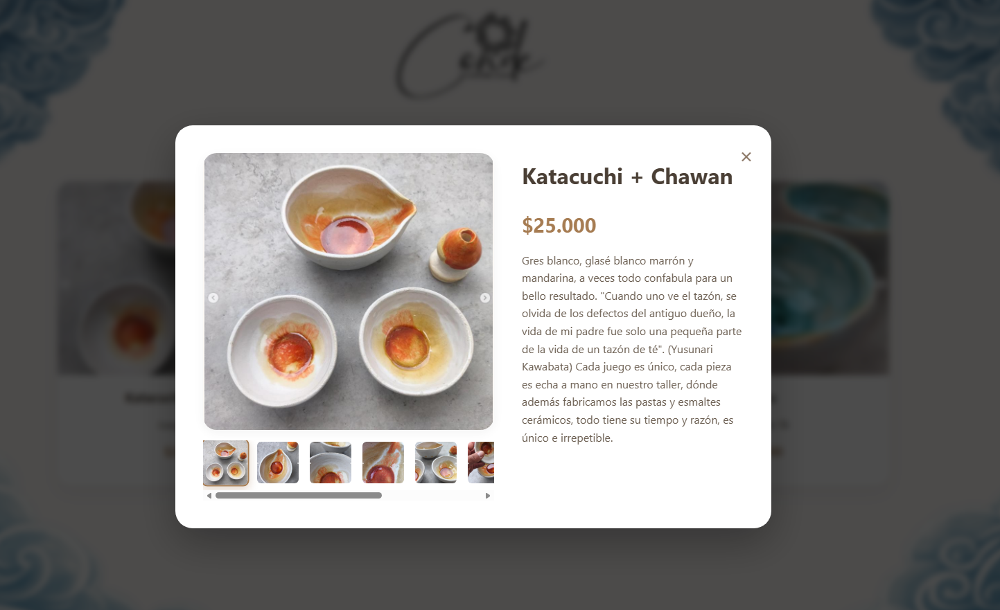
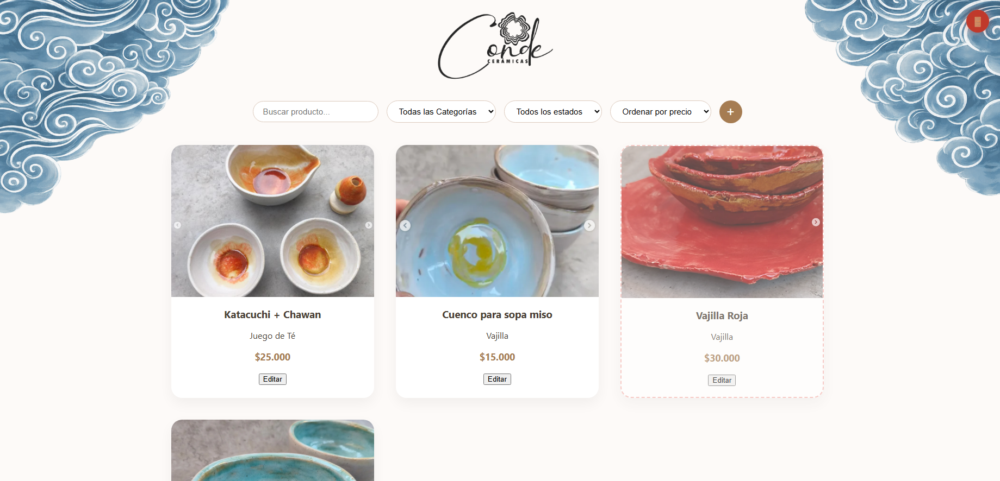
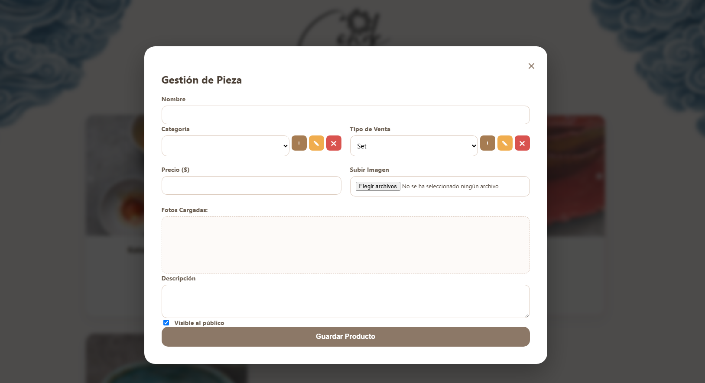

# 🏺 Catálogo Conde Cerámicas

Sistema web para la visualización y gestión del catálogo de productos de **Conde Cerámicas**. El proyecto incluye una interfaz pública para clientes y un panel de administración para la gestión de productos.

---

### 1. 🏠 Página de Inicio (Catálogo Público)
<!-- ================================================================= -->
<!-- 🖼️ MARCADOR 1: AGREGA AQUÍ LA IMAGEN DE LA PÁGINA DE INICIO      -->
<!-- Ruta recomendada: ./assets/inicio.png                             -->
<!-- ================================================================= -->

*Página de inicio del catálogo, accesos rápidos a categorías y barra de navegación.*

---

### 2. 🛍️ Vista Detalle del Producto
<!-- ================================================================= -->
<!-- 🖼️ MARCADOR 2: AGREGA AQUÍ LA IMAGEN DEL DETALLE DE PRODUCTO     -->
<!-- Ruta recomendada: ./assets/detalle-producto.png                   -->
<!-- ================================================================= -->

*Muestra la información detallada del producto: galería de imágenes, especificaciones técnicas y precio.*

---

### 3. ⚙️ Vista de Administración (Panel Admin)
<!-- ================================================================= -->
<!-- 🖼️ MARCADOR 3: AGREGA AQUÍ LA IMAGEN DEL PANEL DE ADMINISTRACIÓN -->
<!-- Ruta recomendada: ./assets/admin-dashboard.png                   -->
<!-- ================================================================= -->

*Vista del administrador para la gestión de productos.*

---

### 4. ⚙️ Agregar Productos (Panel Admin)
<!-- ================================================================= -->
<!-- 🖼️ MARCADOR 4: AGREGA AQUÍ LA IMAGEN DEL PANEL DE ADMINISTRACIÓN -->
<!-- Ruta recomendada: ./assets/admin-dashboard.png                   -->
<!-- ================================================================= -->

*Vista del administrador para agregar nuevos productos.*

---
## ✨ Características del Proyecto

- 🔍 **Búsqueda y Filtros:** Navegación dinámica por categorías de cerámicas y precios.
- 📱 **Diseño Responsive:** Adaptado para dispositivos móviles, tablets y computadores de escritorio.
- 📦 **Gestión de Catálogo (Admin):** Panel privado para agregar, editar o deshabilitar productos.
- 🖼️ **Galería Multimedia:** Carga de múltiples imágenes por producto para mejor visualización.

---

## 🛠️ Tecnologías Utilizadas

- **Frontend:** HTML5 & CSS3 / JavaScript
- **Backend & Base de Datos:** JavaScript / Supabase
- **Estilos / UI:** Tailwind CSS / CSS Modules
- **Control de Versiones:** Git & GitHub
